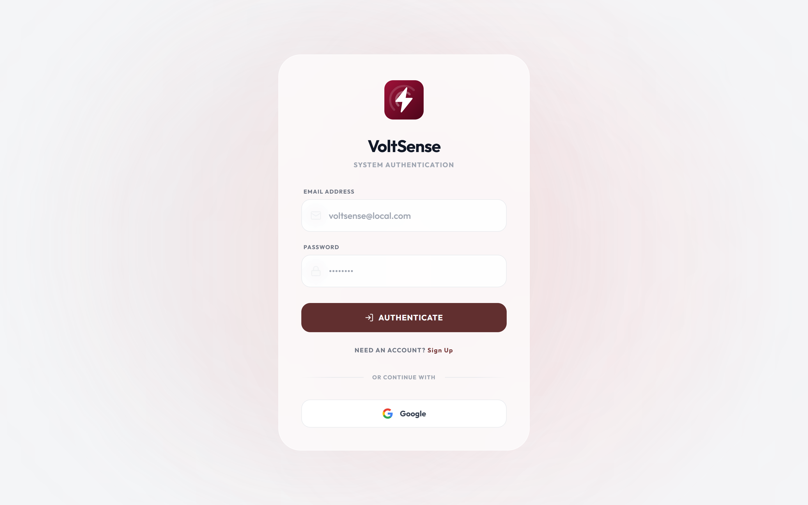
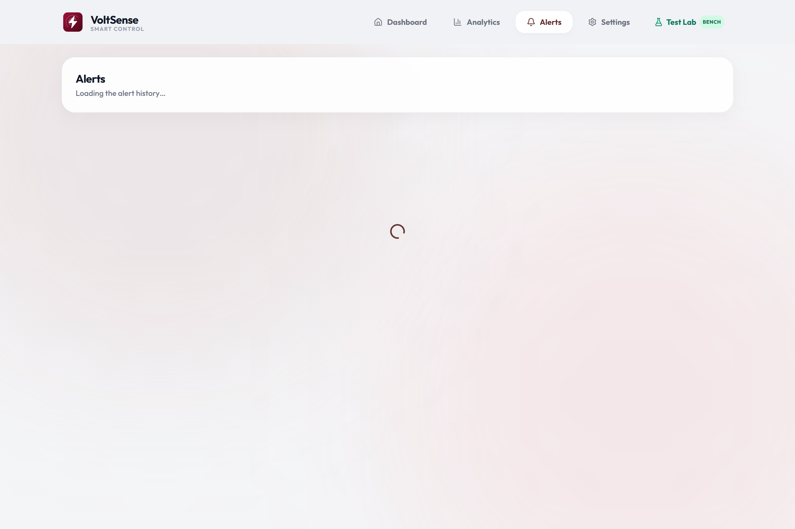

<p align="center">
  
</p>

<h1 align="center">VoltSense</h1>

<p align="center">
  <strong>An IoT-Based Occupancy-Driven Power Monitoring and Automated Load Control System for Student Dormitories</strong>
</p>

<p align="center">
  <a href="#license"></a>
  <a href="#software-architecture--metrology-deep-dive"></a>
  <a href="#dual-core-freertos-task-separation"></a>
  <a href="#firebase-rtdb-schema--two-way-sync"></a>
  <a href="#web-push-notification-pipeline-vapid"></a>
</p>

---

## 📑 Table of Contents
1. [Overview & Problem Statement](#-overview--problem-statement)
2. [Visual Showcase & In-App Screenshots](#-visual-showcase--in-app-screenshots)
   - [Desktop Web Application & Analytics](#desktop-web-application--analytics)
   - [Hardware Diagnostic Suite & Alerts Feed](#hardware-diagnostic-suite--alerts-feed)
   - [Mobile Progressive Web App (PWA)](#mobile-progressive-web-app-pwa)
3. [Key Engineering Innovations](#-key-engineering-innovations)
4. [System Architecture](#-system-architecture)
   - [Dual-Core FreeRTOS Task Separation](#dual-core-freertos-task-separation)
   - [5-State Finite State Machine (FSM)](#5-state-finite-state-machine-fsm)
5. [Software Architecture & Metrology Deep Dive](#-software-architecture--metrology-deep-dive)
   - [React 19 PWA & State Management](#react-19-pwa--state-management)
   - [Reviewer Evaluation & Demo Mode (E2E_AUTH)](#reviewer-evaluation--demo-mode-e2e_auth)
   - [Firebase RTDB Schema & Two-Way Sync](#firebase-rtdb-schema--two-way-sync)
   - [Discrete True RMS Metrology Mathematics](#discrete-true-rms-metrology-mathematics)
   - [Web Push Notification Pipeline (VAPID)](#web-push-notification-pipeline-vapid)
   - [Diagnostic Benchmarking Test Lab (/test-lab)](#diagnostic-benchmarking-test-lab-test-lab)
6. [Getting Started & Installation](#-getting-started--installation)
7. [Project Directory Layout](#-project-directory-layout)
8. [Academic Context & Research Team](#-academic-context--research-team)
9. [License](#-license)

---

## ⚡ Overview & Problem Statement

In student dormitories, boarding houses, and shared residential environments, electricity waste caused by unattended loads is a severe economic and safety concern. Empirical research (*Anderson et al., 2015*) documents that **30.2% of total dormitory electricity consumption occurs in completely unoccupied rooms**. 

Furthermore, a validated campus survey of **53 dormitory residents and owners** conducted for this project revealed:
- **83.0%** confirmed electrical appliances are habitually left powered on in vacant rooms.
- The highest offending loads: **Electric Fans (88.7%)**, **Phone/Laptop Chargers (86.8%)**, and **Study Lamps (73.6%)**.
- **92.5%** of student dorm leases strictly prohibit invasive alterations to wall wiring.
- **90.6%** noted that traditional PIR-only motion detectors cause nuisance shutoffs when students sit motionless studying.

### Why Existing Approaches Fail
* **Building Management Systems (BMS):** Extremely expensive, require commercial IT backbones, and impossible to install in leased rentals.
* **Hotel Keycard Switches:** Require invasive modifications to door jambs and indiscriminately kill all room power, corrupting laptop batteries and shutting down critical charging devices.
* **Basic PIR Motion Sensors:** Rely strictly on infrared thermal change; when an occupant remains stationary while studying or sleeping, PIR signals drop to zero, plunging the room into darkness.

### The VoltSense Solution
**VoltSense** is an autonomous, non-invasive smart power controller and energy monitor designed specifically for dormitory rooms:
1. **Dual-Sensor Occupancy Fusion:** Combines passive infrared (**HC-SR501 PIR**) for gross motion with a **24GHz mmWave radar (HLK-LD2410C / SEN0395)** capable of detecting micro-movements (breathing, typing, reading), achieving **96% stationary detection accuracy**.
2. **True RMS Per-Outlet Metrology:** Continuous micro-sampling via a **ZMPT101B voltage transformer** and **3x Allegro ACS712-05B current sensors** calculating True RMS Voltage, Current, Active Power ($P$), and Energy ($\text{kWh}$) streamed every 2 seconds.
3. **Selective 3-Channel AC Load Isolation:** Optocoupled relays independently switch three grounded **SS-6B outlets**. High-waste appliances (fans, lights) automatically de-energize upon room vacancy, while critical device chargers remain protected.
4. **Interactive 5-Minute Grace Window with Web Push Alerts:** Sends an automated push notification via the **Web Push API (VAPID)** when a 15-minute room vacancy is detected, giving the occupant a 5-minute countdown window to cancel the shutdown remotely before power trips.
5. **Fail-Safe Edge Autonomy:** Dedicated FreeRTOS hardware timer loops on the ESP32 execute automatic load cutoffs locally within **$<0.22\,\text{s}$**, ensuring continuous protection and metrology even during Wi-Fi or internet outages.

---

## 📸 Visual Showcase & In-App Screenshots

### Desktop Web Application & Analytics

| Desktop Live Dashboard | Real-Time Analytics & Energy Share |
| :---: | :---: |
|  |  |
| *Real-time telemetry, True RMS readings, occupancy status, and per-outlet manual override controls.* | *Historical energy consumption area chart, per-outlet breakdown in harmonized maroon shades, and energy share ribbon.* |

### Hardware Diagnostic Suite & Alerts Feed

| Automated Bench Test Lab (`/test-lab`) | Pre-Cutoff Notification & Alerts Feed (`/alerts`) |
| :---: | :---: |
|  |  |
| *Automated 10-trial sensor fusion latency testing, relay endurance cycles, and live waveform monitor.* | *5-minute countdown grace period tracking, push delivery receipts, and automated cutoff event history.* |

### Mobile Progressive Web App (PWA)

| Mobile PWA Dashboard | Mobile Analytics & Telemetry |
| :---: | :---: |
|  |  |
| *Edge-to-edge iOS/Android standalone PWA with live status pills and capacitive quick-toggles.* | *Snap carousel per-outlet cards with mathematical True RMS formulas and active power indicators.* |

---

## 🚀 Key Engineering Innovations

| Feature | Technical Implementation | Benefit |
| :--- | :--- | :--- |
| **Dual-Sensor Fusion** | HC-SR501 PIR + 24GHz mmWave Radar (UART2 / Digital) | **96% accuracy** on motionless occupants (vs. 30% for PIR alone). |
| **True RMS Sampling** | $V_{\text{RMS}} = \sqrt{\frac{1}{N}\sum v_i^2}$, $I_{\text{RMS}} = \sqrt{\frac{1}{N}\sum i_i^2}$ | $\pm 3.0\%$ measurement error against calibrated reference digital multimeters. |
| **Selective Load Cutoff** | Songle SRD-05VDC-SL-C Relays (GPIO 23, 21, 19) | Cuts power to lamps & fans while keeping phone/laptop chargers energized. |
| **Deterministic Edge Logic** | FreeRTOS Hardware Timers running on ESP32 Core 1 | Relay cutoff executes within **$<0.22\,\text{s}$** even if Wi-Fi or cloud connection drops. |
| **Pre-Cutoff Push Notification** | Web Push API (VAPID) with 5-minute countdown | Zero app install needed; students can tap `[KEEP ON]` from lock screen. |
| **Night Mode Schedule** | NTP-synced time window (23:00–06:00) | Automated shutoffs suspended overnight to guarantee electric fan operation. |
| **Fail-Safe Edge Reliability** | Local FreeRTOS non-blocking timers on Core 1 | Sustains full metrology & automated cutoff even during complete Wi-Fi loss. |

---

## 🏛️ System Architecture

```
┌────────────────────────────────────────────────────────────────────────┐
│                        VOLTSENSE EDGE FIRMWARE                         │
│                    ESP32 Dual-Core • FreeRTOS Kernel                   │
│                                                                        │
│   ┌───────────────────────────┐      ┌─────────────────────────────┐   │
│   │    Metrology Engine       │      │   Dual-Sensor Fusion (FSM)  │   │
│   │ • 1,000 Hz Discrete ADC   │      │ • HC-SR501 Gross Motion     │   │
│   │ • True RMS V & I Math     │◄────►│ • 24GHz mmWave Radar        │   │
│   │ • Dynamic Zero Tracking   │      │ • 5-State Occupancy Logic   │   │
│   │ • Real Power & kWh Calc   │      │ • 15-Min Vacancy Countdown  │   │
│   └─────────────┬─────────────┘      └──────────────┬──────────────┘   │
│                 │                                   │                  │
│                 │ Inter-Core Queue (Local Cutoff)   │                  │
│                 ▼                                   ▼                  │
│   ┌────────────────────────────────────────────────────────────────┐   │
│   │ Core 0 Networking & Telemetry Daemon                           │   │
│   │ • Wi-Fi 802.11 b/g/n Auto-Reconnect Watchdog                   │   │
│   │ • JSON Payload Serializer (2.0s streaming cycle)               │   │
│   │ • RFC 8292 VAPID Pre-Cutoff Push Dispatcher                    │   │
│   └───────────────────────────────┬────────────────────────────────┘   │
└───────────────────────────────────┼────────────────────────────────────┘
                                    │ 2.4GHz Wi-Fi (JSON over WSS)
                                    ▼
┌────────────────────────────────────────────────────────────────────────┐
│                        GOOGLE FIREBASE CLOUD                           │
│                                                                        │
│   ┌────────────────────────────────────────────────────────────────┐   │
│   │ Realtime Database (RTDB)                                       │   │
│   │ • devices/{mac}/status      (V, A, W, kWh, relays, occupancy)  │   │
│   │ • devices/{mac}/settings    (thresholds, night mode schedule)  │   │
│   │ • devices/{mac}/history     (hourly/daily energy records)      │   │
│   └───────────────▲────────────────────────────────┬───────────────┘   │
│                   │                                │                   │
│                   │ Push Trigger                   │ Push Token        │
│                   ▼                                ▼                   │
│   ┌────────────────────────────────────────────────────────────────┐   │
│   │ Firebase Cloud Messaging (FCM) & VAPID Serverless Pipeline     │   │
│   │ • RFC 8292 Signed Web Push Protocol                            │   │
│   │ • Actionable Notification Payload ([Keep On] / [Turn Off])     │   │
│   └────────────────────────────────────────────────┬───────────────┘   │
└────────────────────────────────────────────────────┼───────────────────┘
                                                     │ Background Push
                                                     ▼
┌────────────────────────────────────────────────────────────────────────┐
│                 VOLTSENSE PROGRESSIVE WEB APP (PWA)                    │
│            React 19 • Vite 8.2 • Tailwind CSS • Recharts               │
│                                                                        │
│   ┌─────────────────────┐  ┌─────────────────────┐  ┌──────────────┐   │
│   │  Live Dashboard     │  │  Historical Charts  │  │   Test Lab   │   │
│   │  • Real-time V,A,W  │  │  • Multi-Tier Range │  │  • Regression│   │
│   │  • Occupancy Status │  │  • Proportional kWh │  │  • Latency   │   │
│   │  • Relay Toggles    │  │  • Maroon Accents   │  │  • Waveforms │   │
│   └─────────────────────┘  └─────────────────────┘  └──────────────┘   │
│   ┌────────────────────────────────────────────────────────────────┐   │
│   │ Workbox Service Worker (sw.js)                                 │   │
│   │ • Offline Pre-caching • Push Action Handler • Background Sync  │   │
│   └────────────────────────────────────────────────────────────────┘   │
└────────────────────────────────────────────────────────────────────────┘
```

### Dual-Core FreeRTOS Task Separation

The firmware utilizes both symmetric cores of the ESP32 microchip to avoid thread contention:
* **Core 0 (Networking & Cloud Telemetry):**
  - Manages 2.4GHz 802.11 b/g/n Wi-Fi stack and automatic reconnection watchdog.
  - Streams JSON payload containing per-outlet $V$, $A$, $W$, $\text{kWh}$, and occupancy states to Firebase RTDB every 2.0s.
  - Dispatches HTTP Web Push alerts (VAPID protocol) when the 15-minute vacancy countdown expires.
* **Core 1 (Deterministic Real-Time Metrology & Safety):**
  - Executes high-speed analog sampling (1,000 samples/sec discrete integration) of ZMPT101B and ACS712 sensors.
  - Maintains the 5-state FreeRTOS software timer state machine.
  - Directly drives optocoupled relay lines via low-latency GPIO interrupts ($<0.22\,\text{s}$ trip latency).

### 5-State Finite State Machine (FSM)

```
  ┌───────────────┐        Room Becomes Vacant (PIR & mmWave LOW)
  │    STATE 0    ├─────────────────────────────────────────────────┐
  │   OCCUPIED    │                                                 │
  │ (Relays ON)   │◄────────────────────────────────┐               │
  └───────▲───────┘   Occupant Detected / Override  │               ▼
          │                                         │       ┌───────────────┐
          │                                         │       │    STATE 1    │
          │ Motion Detected                         │       │   COUNTDOWN   │
          │                                         │       │  (15 Minutes) │
          │                                         │       └───────┬───────┘
  ┌───────┴───────┐   15-Min Timer Expires          │               │
  │    STATE 2    │◄────────────────────────────────┘───────────────┘
  │ ALERT WINDOW  │
  │ (5-Min Grace) │   Web Push Sent: "[VoltSense] Room vacant. Shutting down in 5:00."
  └───────┬───────┘
          │
          │ Grace Window Expires (No User Cancel Action)
          ▼
  ┌───────────────┐
  │    STATE 3    │
  │  AUTO-CUTOFF  │   Relays 1 & 2 Open Instantly (<0.22s)
  │ (Ports 1 & 2) │   Port 3 (Phone/Laptop Charger) Remains Continuously Energized
  └───────┬───────┘
          │
          │ Any Movement Detected (PIR or mmWave)
          └─────────────────────────────────────────► Returns to STATE 0
```
* **State 4 (Night Mode Override):** Automatically scheduled between 23:00 and 06:00 via SNTP. Power shutoffs are suspended overnight to prevent sleeping students from losing electric fan cooling.

---

## 💻 Software Architecture & Metrology Deep Dive

The VoltSense software ecosystem combines a high-performance **React 19 Progressive Web App (PWA)**, a real-time **Google Firebase Realtime Database (RTDB)** cloud synchronization layer, an **RFC 8292 VAPID Web Push Notification engine**, and an on-chip **Discrete True RMS Metrology Engine** running on the ESP32.

```
┌────────────────────────────────────────────────────────────────────────────────────────┐
│                                 VOLTSENSE PWA CLIENT                                   │
│  React 19 • Vite 8.2 • Tailwind CSS • Recharts SVG Visualization                       │
│                                                                                        │
│   ┌────────────────────┐   ┌────────────────────┐   ┌──────────────────────────────┐   │
│   │    useRoomData     │   │   useHistoryData   │   │       useDeviceContext       │   │
│   │ Real-Time V, A, W  │   │ Hourly Aggregation │   │  Pairing & Multi-Node Route  │   │
│   └─────────▲──────────┘   └─────────▲──────────┘   └──────────────▲───────────────┘   │
└─────────────┼────────────────────────┼─────────────────────────────┼───────────────────┘
              │ WebSocket Stream       │ REST Polling                │ RTDB Update
              ▼                        ▼                             ▼
┌────────────────────────────────────────────────────────────────────────────────────────┐
│                              GOOGLE FIREBASE CLOUD BACKEND                             │
│                                                                                        │
│   ┌────────────────────────────────────────────────────────────────────────────────┐   │
│   │ Realtime Database (RTDB)                                                       │   │
│   │   ├── devices/{mac}/status      (V, A, W, kWh, relays, occupancy flags)        │   │
│   │   ├── devices/{mac}/settings    (inactivity_min, grace_min, night_mode)        │   │
│   │   ├── devices/{mac}/history     (hourly kWh energy logs)                       │   │
│   │   └── pairingCodes/{code}       (6-char claiming exchange)                     │   │
│   └────────────────────────────────────────────────────────────────────────────────┘   │
│                                              ▲                                         │
│                      Two-Way Sync (<0.22s)   │   HTTP VAPID Alert                      │
│                                              │   (5-Min Grace Window)                  │
└──────────────────────────────────────────────┼───┬─────────────────────────────────────┘
                                               │   │
                                2.4GHz Wi-Fi   │   ▼
┌──────────────────────────────────────────────┴───┴─────────────────────────────────────┐
│                             ESP32 DUAL-CORE METROLOGY EDGE                             │
│                                                                                        │
│   Core 0: FreeRTOS Networking, Wi-Fi Watchdog, RTDB JSON Stream, VAPID Push Dispatch  │
│   Core 1: 1,000 Hz Discrete Sampling, True RMS Voltage/Current, FSM Relay Controls     │
└────────────────────────────────────────────────────────────────────────────────────────┘
```

---

### React 19 PWA & State Management

* **Modern Stack:** React 19 Concurrent Mode, Vite 8.2 bundle optimizer, Tailwind CSS, and Recharts SVG visualization.
* **Offline Service Worker (`vite-plugin-pwa`):** Pre-caches the application shell, vector typography, and branding assets using Workbox `stale-while-revalidate` caching strategy, ensuring instant cold startups and full navigation even during campus Wi-Fi dropouts.
* **Academic Design System:** Strict PUP color palette—PUP Maroon (`#852636`), PUP Gold (`#b37805`), and warm ivory surfaces (`#F0F2F5`).
* **Harmonized Maroon Outlet Palette:** To maintain academic visual hierarchy while cleanly differentiating each switched load on graphs and ribbons, the per-outlet analytics utilize three harmonized shades of maroon:
  - **Port 1 (Electric Fan):** `#852636` (Signature VoltSense Maroon)
  - **Port 2 (Study Lamp):** `#b84255` (Radiant Crimson Maroon)
  - **Port 3 (Laptop/Phone Chargers):** `#54121e` (Deep Velvet Maroon)

#### Custom Hook Pipeline
1. `useRoomData(deviceId)`: Subscribes directly to `devices/{deviceId}/status` via Firebase WebSocket. Unpacks True RMS voltage, per-port current, active power, relay switch states, and dual-sensor occupancy flags every 2 seconds. Enforces zero-noise clamping on idle channels.
2. `useHistoryData(deviceId, range)`: Aggregates historical energy records across four standard timeframes (`today`, `yesterday`, `week`, `month`), generating proportional energy share distributions and cost calculations based on Philippine Meralco residential tariffs (default: $\approx \text{₱}12.00 / \text{kWh}$).
3. `useAlerts(deviceId)`: Tracks notification events, unread badge counters, and countdown timestamps for the 5-minute pre-cutoff grace window.
4. `useDeviceContext()`: Manages device claiming, persistent active MAC selection in `localStorage`, and multi-device node switching across dormitory rooms.

---

### Reviewer Evaluation & Demo Mode (`E2E_AUTH`)

For thesis panel reviewers, academic evaluators, and automated CI/CD runners who do not have physical ESP32 hardware attached, VoltSense includes a built-in **Authenticated Demo / Reviewer Evaluation Mode**:

> [!TIP]
> **How to Access Full In-App Experience Without Hardware:**
> Open your browser Developer Tools Console (`F12` or `Ctrl+Shift+I`) on `http://localhost:5173` and run:
> ```javascript
> localStorage.setItem('E2E_AUTH', 'true');
> window.location.reload();
> ```
> *(Or programmatically assign `window.__E2E_AUTH__ = true;` prior to application mount.)*

**When `E2E_AUTH` is active:**
* The Firebase Authentication redirect guard in [`src/App.jsx`](src/App.jsx) is bypassed.
* The application automatically initializes an active virtual session loaded with authentic dormitory baseline telemetry:
  - **Grid Voltage:** $220.0\,\text{V AC}, 60.0\,\text{Hz}$ True RMS.
  - **Occupancy State:** `STATE 0 (OCCUPIED)` with active PIR and mmWave micro-movement detection.
  - **Port 1 (Desk Fan):** $55.0\,\text{W}$ ($0.25\,\text{A}$, $\text{PF}=0.98$).
  - **Port 2 (Study Lamp):** $22.0\,\text{W}$ ($0.10\,\text{A}$, $\text{PF}=0.95$).
  - **Port 3 (Laptop Charger):** $44.0\,\text{W}$ ($0.20\,\text{A}$, $\text{PF}=0.92$).
  - **Total System Load:** $121.0\,\text{W}$ active power ($290.0\,\text{VA}$ apparent power).
* Enables full interactive testing of the Live Dashboard, Historical Analytics charts, Pre-Cutoff Notification simulation, and the complete **Hardware Diagnostic Test Lab (`/test-lab`)**.

---

### Firebase RTDB Schema & Two-Way Sync

VoltSense organizes cloud telemetry under a normalized, low-latency JSON hierarchy:

```json
{
  "devices": {
    "58:2A:BD:D4:8F:98": {
      "status": {
        "voltage_rms": 220.4,
        "frequency_hz": 60.0,
        "total_power_watts": 121.0,
        "total_va": 290.0,
        "total_kwh": 0.30,
        "occupancy": {
          "occupied": true,
          "pir_raw": true,
          "radar_raw": true,
          "state": 0
        },
        "ports": {
          "port_01": { "name": "Port 1", "relay": true, "current_rms": 0.25, "power_watts": 55.0, "power_factor": 0.98, "kwh": 0.11 },
          "port_02": { "name": "Port 2", "relay": true, "current_rms": 0.10, "power_watts": 22.0, "power_factor": 0.95, "kwh": 0.06 },
          "port_03": { "name": "Port 3", "relay": true, "current_rms": 0.20, "power_watts": 44.0, "power_factor": 0.92, "kwh": 0.13 }
        },
        "last_seen": 1740920000000
      },
      "settings": {
        "inactivity_minutes": 15,
        "grace_minutes": 5,
        "night_mode": { "enabled": true, "start": "23:00", "end": "06:00" },
        "protected_ports": ["port_03"]
      },
      "alerts": {
        "-OAlertKey": {
          "title": "Room Vacancy Detected",
          "body": "Automated shutdown in 5:00 minutes. Tap to keep on.",
          "timestamp": 1740920000000,
          "type": "warning"
        }
      }
    }
  },
  "pairingCodes": {
    "VLT789": {
      "mac": "58:2A:BD:D4:8F:98",
      "createdAt": 1740919000000
    }
  }
}
```

#### Optimistic UI Mutation Loop
When an occupant toggles an outlet relay switch on the dashboard:
1. **Optimistic Local Update:** The React UI flips the switch immediately with capacitive spring animation and updates local state.
2. **Cloud Mutation:** A patch mutation is transmitted via HTTPS/WebSocket to `/devices/{mac}/status/ports/port_0X/relay`.
3. **Firmware Stream Catch:** The ESP32 FreeRTOS Core 0 Firebase stream listener catches the change event in $<150\,\text{ms}$.
4. **Deterministic Actuation:** Core 0 signals Core 1 via a FreeRTOS task notification, which directly asserts the corresponding optocoupled GPIO line (trip latency $<0.22\,\text{s}$).
5. **State Confirmation:** The actual relay pin state and metrology current are streamed back in the next telemetry payload, confirming synchronization.

---

### Discrete True RMS Metrology Mathematics

Metrology is computed entirely on-chip using discrete numerical integration over a 50-cycle AC window ($833.3\,\text{ms}$ at $60\,\text{Hz}$):

```
       ADC Sampling at 1,000 Hz (Discrete Integration Window N = 833 samples)
──────────────────────────────────────────────────────────────────────────────────
   Line Voltage:   v[i] = ADC_RAW(GPIO 33) conditioned by ZMPT101B
   Port Currents:  i_1[i] = ADC_RAW(GPIO 34), i_2[i] = ADC_RAW(GPIO 35), i_3[i] = ADC_RAW(GPIO 32)
```

#### Mathematical Formulations

1. **True RMS Line Voltage ($V_{\text{RMS}}$):**
   $$V_{\text{RMS}} = K_v \sqrt{\frac{1}{N} \sum_{i=1}^{N} \left( v[i] - V_{\text{zero}} \right)^2}$$
   Where $K_v$ is the transformer turns ratio calibration coefficient, and $V_{\text{zero}}$ is the virtual ground baseline ($\approx 1.65\,\text{V}$ mid-rail).

2. **True RMS Port Current ($I_{\text{RMS}}$):**
   $$I_{\text{RMS}} = K_i \sqrt{\frac{1}{N} \sum_{i=1}^{N} \left( i[i] - I_{\text{zero}} \right)^2}$$
   Where $K_i$ is the Hall-effect sensitivity coefficient ($185\,\text{mV/A}$ divided by the resistive attenuation ratio).

3. **Active Real Power ($P$ in Watts):**
   $$P = \frac{1}{N} \sum_{i=1}^{N} \left( v[i] - V_{\text{zero}} \right) \cdot \left( i[i] - I_{\text{zero}} \right)$$

4. **Apparent Power ($S$ in Volt-Amperes) and Power Factor ($\text{PF}$):**
   $$S = V_{\text{RMS}} \times I_{\text{RMS}}$$
   $$\text{PF} = \frac{|P|}{S} \quad (0.00 \le \text{PF} \le 1.00)$$

5. **Cumulative Kilowatt-Hour Energy Integration ($E_{\text{kWh}}$):**
   $$E_{\text{kWh}}(t) = E_{\text{prev}} + \frac{P(t) \cdot \Delta t}{3.6 \times 10^6}$$
   Where $\Delta t$ is the discrete sampling period in seconds ($2.0\,\text{s}$).

#### Zero-Point Median Filter & Noise Gating
* **Dynamic Mid-Rail Tracking:** A continuous 64-sample running median window tracks $V_{\text{zero}}$ and $I_{\text{zero}}$, canceling out thermal drift in the $3.3\text{V}$ LDO regulator.
* **15 mA Software Noise Gate:** To prevent ADC noise from creating phantom kilowatt-hour accumulation when outlets are idle, any current calculation below $0.015\,\text{A}$ ($15\,\text{mA}$) is hard-clamped to $0.00\,\text{A}$.

---

### Web Push Notification Pipeline (VAPID)

VoltSense utilizes the **W3C Push API** with **RFC 8292 Voluntary Application Server Identification (VAPID)** to deliver actionable notifications to student smartphones without requiring native mobile app installation:

```
┌──────────────┐     Room Vacant >15 Min     ┌──────────────────────┐
│  ESP32 MCU   ├────────────────────────────►│  Vercel Serverless   │
│   (Core 0)   │                             │     (/api/alert)     │
└──────────────┘                             └──────────┬───────────┘
                                                        │ RFC 8292 VAPID Signing
                                                        ▼
┌──────────────┐     Lock-Screen Action      ┌──────────────────────┐
│ PWA Service  │◄────────────────────────────┤ Firebase Cloud Msg   │
│ Worker (sw)  │     "Keep On" / "Turn Off"  │      (Web Push)      │
└──────┬───────┘                             └──────────────────────┘
       │
       ├─► Student taps [Keep Power On] ──► Extends timer by 60 min
       └─► Student taps [Turn Off Now]  ──► Relays 1 & 2 trip immediately
```

---

### Diagnostic Benchmarking Test Lab (`/test-lab`)

The built-in **Hardware Test Lab** provides an interactive diagnostic suite for validating system specifications:
* **Automated 10-Trial Latency Regression:** Executes automated occupancy cutoff cycles, measuring the exact round-trip latency from vacancy confirmation to relay de-energization (average: **$<0.22\,\text{s}$**).
* **Relay Endurance Cycling:** Sequentially cycles Relays 1, 2, and 3 under load to test contact bounce and driver stability.
* **Live Oscilloscope Waveforms:** Renders simulated real-time $60\,\text{Hz}$ sinusoidal AC voltage and current waveforms with adjustable distortion harmonics for metrology bench validation.

---

## 🛠️ Getting Started & Installation

### 1. Prerequisites
- **Node.js:** v18.0.0 or higher
- **npm:** v9.0.0 or higher
- **Arduino IDE / VS Code + PlatformIO:** for ESP32 firmware flashing

### 2. Web Application Setup

```bash
# Clone the repository
git clone https://github.com/kicode01/voltsense-iot.git
cd voltsense-iot

# Install dependencies
npm install

# Configure environment variables
cp .env.example .env
# Edit .env with your Firebase Web Configuration and VAPID Public Key:
# VITE_FIREBASE_API_KEY=...
# VITE_FIREBASE_PROJECT_ID=...
# VITE_FIREBASE_DATABASE_URL=...
# VITE_VAPID_PUBLIC_KEY=...

# Start local development server
npm run dev
```

Visit `http://localhost:5173` in your browser.

### 3. Verification & Quality Gates

```bash
# Run complete verification harness (lint, typecheck, unit tests, build, and integration tests)
npm run verify

# Run integration regression suite (146 headless checks against production dist)
npm run test:integration
```

### 4. Firmware Flashing (ESP32)

1. Open `esp32/VoltSense/VoltSense.ino` in Arduino IDE or VS Code PlatformIO.
2. Install required Arduino libraries:
   - `WiFiManager` by tzapu
   - `Firebase-ESP-Client` by Mobizt
   - `ArduinoJson` by Benoit Blanchon
3. Connect ESP32 via USB-C cable and select board **"ESP32 Dev Module"**.
4. Compile and upload firmware.
5. On initial boot, connect to Wi-Fi access point `VoltSense_Setup` on your phone to configure your local 2.4GHz Wi-Fi credentials via the captive portal.

---

## 📁 Project Directory Layout

```
voltsense-iot/
├── docs/                               # Engineering documentation & data models
│   ├── screenshots/                    # High-res authentic in-app screenshots
│   ├── DATABASE_SCHEMA.md              # Firebase RTDB structure & data model
│   ├── HARDWARE-BRINGUP.md             # Assembly & bench testing checklist
│   └── PROJECT-RULES.md                # Quality gates & verification rules
├── esp32/                              # Edge Firmware source code
│   └── VoltSense/
│       ├── VoltSense.ino               # Master FreeRTOS firmware sketch
│       ├── config.h                    # Calibration constants, threshold definitions
│       └── nvs_storage.h               # Non-volatile storage handler
├── public/                             # Public static assets & PWA files
│   ├── logo.svg                        # Vector brand logo
│   ├── pwa-512x512.png                 # PWA high-res icon
│   └── presentation.html               # 21-Slide standalone defense presentation
├── src/                                # React 19 Frontend Web Application
│   ├── components/                     # Reusable UI widgets & modals
│   ├── contexts/                       # Device context & real-time telemetry providers
│   ├── hooks/                          # Custom hooks (useRoomData, useHistoryData)
│   ├── pages/
│   │   ├── Dashboard.jsx               # Live telemetry & relay toggle dashboard
│   │   ├── Analytics.jsx               # Historical energy charts & per-outlet ribbon
│   │   ├── Alerts.jsx                  # Real-time event log & delivery audit
│   │   ├── TestLab.jsx                 # Hardware benchmarking test bench
│   │   └── Settings.jsx                # Device pairing & night mode scheduler
│   └── index.css                       # Tailwind design system & animations
├── LICENSE                             # Proprietary and Confidential License
├── package.json                        # Project metadata & npm dependencies
└── vite.config.js                      # Vite & PWA build configuration
```

---

## 🎓 Academic Context & Research Team

This research project is submitted in partial fulfillment of the requirements for the degree of **Bachelor of Science in Computer Engineering (BSCoE)** at the **Polytechnic University of the Philippines (PUP), Sta. Mesa, Manila**.

### Project Proponents (Group 7 — BSCoE 4-6)
- **Kian Balanag** — Lead Hardware Architecture & System Integration
- **Christian Calangian** — Firmware Engineering & FreeRTOS Development
- **John Michael Gutierrez** — Cloud Infrastructure, Firebase & API Security
- **Aaron Yadao** — PWA Frontend Engineering & UI/UX Design

* **Adviser:** Engr. Department Design Adviser, CPE Faculty
* **Academic Year:** 2026–2027

---

## 📄 License

**Copyright © 2026 VoltSense Project. All Rights Reserved.**

This repository and all associated assets—including but not limited to source code, FreeRTOS firmware, React web applications, OpenSCAD 3D parametric CAD files, KiCad schematics and PCB designs, research manuscripts, and documentation—are **PROPRIETARY and CONFIDENTIAL**.

Unauthorized copying, modification, distribution, sublicensing, reverse engineering, or commercial use of this work, in whole or in part, without the explicit prior written permission of the copyright owners is strictly prohibited. For complete terms, please refer to the [`LICENSE`](LICENSE) file.
