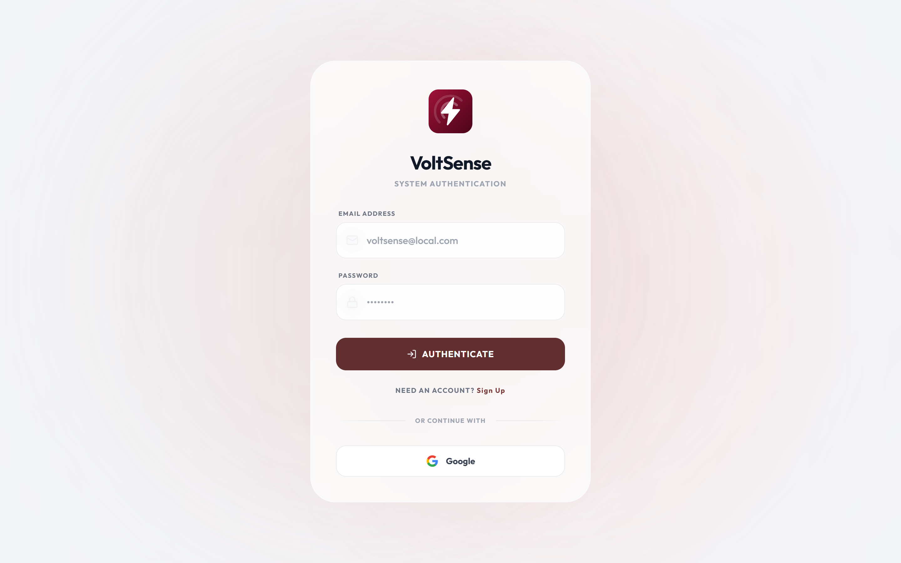
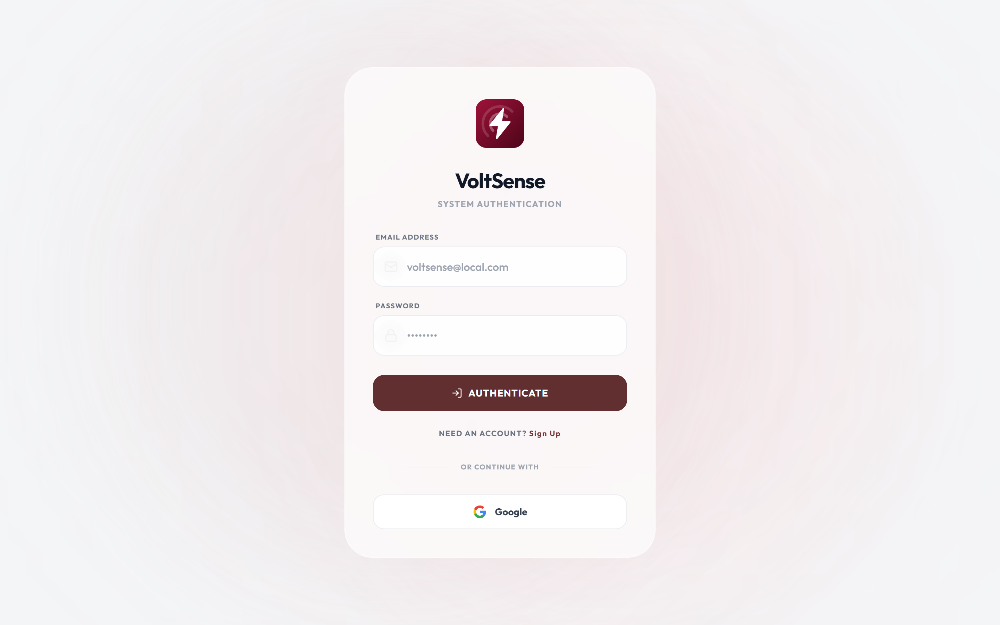
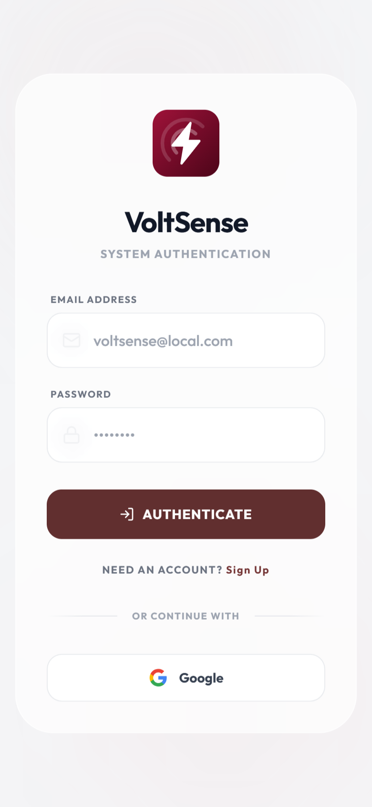
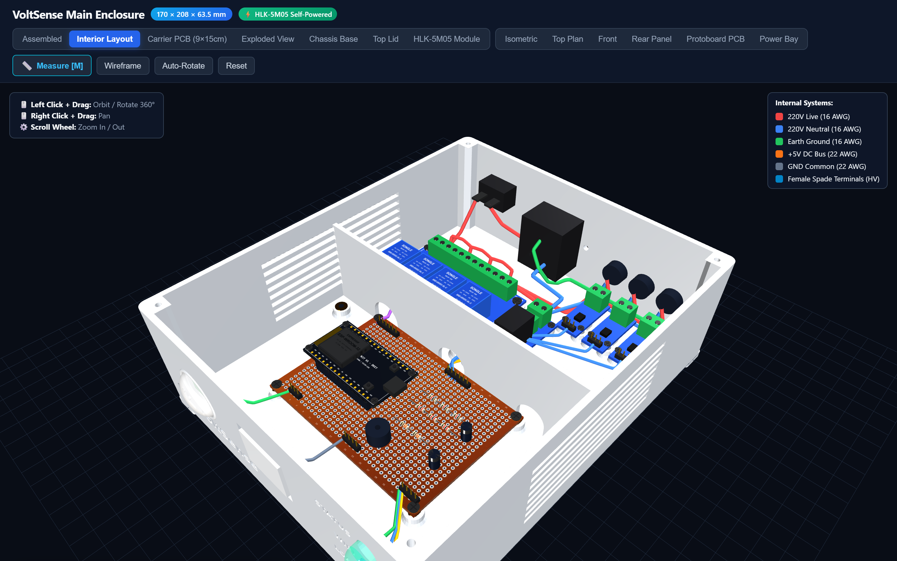

<p align="center">
  
</p>

<h1 align="center">VoltSense</h1>

<p align="center">
  <strong>An IoT-Based Occupancy-Driven Power Monitoring and Automated Load Control System for Student Dormitories</strong>
</p>

<p align="center">
  <a href="#license"></a>
  <a href="#software-stack"></a>
  <a href="#firmware-architecture"></a>
  <a href="#firmware-architecture"></a>
  <a href="#cloud--database"></a>
  <a href="#3d-parametric-cad-enclosure"></a>
</p>

---

## 📑 Table of Contents
1. [Overview & Problem Statement](#-overview--problem-statement)
2. [Visual Showcase & Screenshots](#-visual-showcase--screenshots)
   - [Web Application & Mobile PWA](#web-application--mobile-pwa)
   - [3D Digital Twin & Parametric CAD Enclosure](#3d-digital-twin--parametric-cad-enclosure)
   - [Electrical Schematics & Wiring](#electrical-schematics--wiring)
3. [Key Engineering Innovations](#-key-engineering-innovations)
4. [System Architecture](#-system-architecture)
   - [Dual-Core FreeRTOS Task Separation](#dual-core-freertos-task-separation)
   - [5-State Finite State Machine (FSM)](#5-state-finite-state-machine-fsm)
5. [Hardware Specifications & Pinout](#-hardware-specifications--pinout)
6. [3D Parametric CAD Enclosure](#-3d-parametric-cad-enclosure)
7. [Software & PWA Features](#-software--pwa-features)
8. [Getting Started & Installation](#-getting-started--installation)
9. [Project Directory Layout](#-project-directory-layout)
10. [Academic Context & Research Team](#-academic-context--research-team)
11. [License](#-license)

---

## ⚡ Overview & Problem Statement

In student dormitories, boarding houses, and shared residential environments, electricity waste caused by unattended loads is a severe economic and safety concern. Empirical research (*Anderson et al., 2015*) documents that **30.2% of total dormitory electricity consumption occurs in completely unoccupied rooms**. 

Furthermore, a validated campus survey of **53 dormitory residents and owners** conducted for this project revealed:
- **83.0%** confirmed electrical appliances are habitually left powered on in vacant rooms.
- The highest offending loads: **Electric Fans (88.7%)**, **Phone/Laptop Chargers (86.8%)**, and **Study Lamps (73.6%)**.
- **92.5%** of student dorm leases strictly prohibit invasive alterations to wall wiring.
- **90.6%** noted that traditional PIR-only motion detectors cause nuisance shutoffs when students sit motionless studying.

### Why Existing Approaches Fail
* **Building Management Systems (BMS):** Extremely expensive, require commercial IT backbones, and impossible to install in leased rentals.
* **Hotel Keycard Switches:** Require invasive modifications to door jambs and indiscriminately kill all room power, corrupting laptop batteries and shutting down critical charging devices.
* **Basic PIR Motion Sensors:** Rely strictly on infrared thermal change; when an occupant remains stationary while studying or sleeping, PIR signals drop to zero, plunging the room into darkness.

### The VoltSense Solution
**VoltSense** is an autonomous, non-invasive smart power controller and energy monitor designed specifically for dormitory rooms:
1. **Dual-Sensor Occupancy Fusion:** Combines passive infrared (**HC-SR501 PIR**) for gross motion with a **24GHz mmWave radar (HLK-LD2410C / SEN0395)** capable of detecting micro-movements (breathing, typing, reading), achieving **96% stationary detection accuracy**.
2. **True RMS Per-Outlet Metrology:** Continuous micro-sampling via a **ZMPT101B voltage transformer** and **3x Allegro ACS712-05B current sensors** calculating True RMS Voltage, Current, Active Power ($P$), and Energy ($\text{kWh}$) streamed every 2 seconds.
3. **Selective 3-Channel AC Load Isolation:** Optocoupled relays independently switch three grounded **SS-6B outlets**. High-waste appliances (fans, lights) automatically de-energize upon room vacancy, while critical device chargers remain protected.
4. **Interactive 5-Minute Grace Window with Web Push Alerts:** Sends an automated push notification via the **Web Push API (VAPID)** when a 15-minute room vacancy is detected, giving the occupant a 5-minute countdown window to cancel the shutdown remotely before power trips.
5. **Flame-Retardant Industrial Chassis:** Parametric 3D-printed PETG housing with an internal physical barrier enforcing **$>6.3\,\text{mm}$ creepage distance** between 220V AC mains and low-voltage DC logic in strict compliance with the **Philippine Electrical Code (PEC)**.

---

## 📸 Visual Showcase & Screenshots

### Web Application & Mobile PWA

| Desktop Live Dashboard | Real-Time Analytics & Energy Share |
| :---: | :---: |
|  |  |
| *Real-time telemetry, True RMS readings, occupancy status, and per-outlet manual override controls.* | *Historical energy consumption area chart, per-outlet breakdown in harmonized maroon shades, and energy share ribbon.* |

| Mobile PWA Dashboard | Mobile Analytics & Telemetry |
| :---: | :---: |
|  |  |
| *Edge-to-edge iOS/Android standalone PWA with live status pills and capacitive quick-toggles.* | *Snap carousel per-outlet cards with mathematical True RMS formulas and active power indicators.* |

---

### 3D Digital Twin & Parametric CAD Enclosure

| Interactive 3D Digital Twin Viewer | Full Exploded Assembly View |
| :---: | :---: |
|  |  |
| *Real-time Three.js WebGL digital twin rendering all internal carrier PCB standoffs, relays, and sensors.* | *Exploded view showing base chassis, universal protoboard, sensor brackets, and top lid.* |

| Isometric Assembled Enclosure | Interior Layout & Safety Partition Wall |
| :---: | :---: |
|  |  |
| *Heavy-duty flame-retardant PETG enclosure with front sensor ports and rear cable grommets.* | *Interior showing the $48\,\text{mm}$ high AC/DC partition barrier with 3 segregated wiring portals.* |

---

### Electrical Schematics & Wiring

<p align="center">
  <br/>
  <em>Complete wiring topology: IEC C14 inlet, KCD1 switch, HLK-5M05 AC-DC converter, ZMPT101B, 3x ACS712, 4-Ch Relay Module, and ESP32 DevKit V1.</em>
</p>

---

## 🚀 Key Engineering Innovations

| Feature | Technical Implementation | Benefit |
| :--- | :--- | :--- |
| **Dual-Sensor Fusion** | HC-SR501 PIR + 24GHz mmWave Radar (UART2 / Digital) | **96% accuracy** on motionless occupants (vs. 30% for PIR alone). |
| **True RMS Sampling** | $V_{\text{RMS}} = \sqrt{\frac{1}{N}\sum v_i^2}$, $I_{\text{RMS}} = \sqrt{\frac{1}{N}\sum i_i^2}$ | $\pm 3.0\%$ measurement error against calibrated reference digital multimeters. |
| **Selective Load Cutoff** | Songle SRD-05VDC-SL-C Relays (GPIO 23, 21, 19) | Cuts power to lamps & fans while keeping phone/laptop chargers energized. |
| **Deterministic Edge Logic** | FreeRTOS Hardware Timers running on ESP32 Core 1 | Relay cutoff executes within **$<0.22\,\text{s}$** even if Wi-Fi or cloud connection drops. |
| **Pre-Cutoff Push Notification** | Web Push API (VAPID) with 5-minute countdown | Zero app install needed; students can tap `[KEEP ON]` from lock screen. |
| **Night Mode Schedule** | NTP-synced time window (23:00–06:00) | Automated shutoffs suspended overnight to guarantee electric fan operation. |
| **Galvanic & Thermal Safety** | $>6.3\,\text{mm}$ PCB Creepage + UL94 V-0 PETG | Fully conforms to Philippine Electrical Code (PEC) Article 2.10 branch standards. |

---

## 🏛️ System Architecture

```
                  ┌────────────────────────────────────────────────────────┐
                  │                    VOLTSENSE EDGE                      │
                  │                                                        │
┌──────────────┐  │  ┌───────────────┐     Discrete ADC     ┌───────────┐  │
│ 220V AC Line ├─────► ZMPT101B Xfmr ├────────────────────►│           │  │
└──────────────┘  │  └───────────────┘                      │           │  │
┌──────────────┐  │  ┌───────────────┐  185 mV/A Isolated   │   ESP32   │  │
│ 3x AC Outlets◄─────┤ 4-Ch Relay Mod│◄─────────────────────┤ Dual-Core │  │
└──────────────┘  │  └───────────────┘  Songle SRD-05VDC    │   MCU     │  │
┌──────────────┐  │  ┌───────────────┐                      │ (FreeRTOS)│  │
│ 3x Load Amps ├─────► 3x ACS712 Mod ├─────────────────────►│           │  │
└──────────────┘  │  └───────────────┘                      │           │  │
┌──────────────┐  │  ┌───────────────┐  Sensor Fusion       │           │  │
│ PIR + mmWave ├─────► HC-SR501/Radar├─────────────────────►│           │  │
└──────────────┘  │  └───────────────┘                      └───┬───▲───┘  │
                  └─────────────────────────────────────────────┼───┼──────┘
                                                                │   │
                                           2.4GHz Wi-Fi (JSON)  │   │ Live Toggles
                                           2-Sec Telemetry Sync │   │ & State Resync
                                                                ▼   │
                  ┌─────────────────────────────────────────────────┴──────┐
                  │                 GOOGLE FIREBASE CLOUD                  │
                  │                                                        │
                  │   ┌────────────────────────┐  ┌────────────────────┐   │
                  │   │ Realtime Database      │  │ Cloud Messaging    │   │
                  │   │ (V, A, W, kWh, Relays) │  │ (Web Push / VAPID) │   │
                  │   └───────────▲────────────┘  └─────────┬──────────┘   │
                  └───────────────┼─────────────────────────┼──────────────┘
                                  │ Live Subscriptions      │ Push Alerts
                                  │ & REST mutations        │ (5-min window)
                                  ▼                         ▼
                  ┌────────────────────────────────────────────────────────┐
                  │             PROGRESSIVE WEB APPLICATION (PWA)          │
                  │         React 19 • Vite • Tailwind CSS • Recharts      │
                  │                                                        │
                  │    [Live Telemetry]   [Per-Outlet Controls]            │
                  │    [Energy Analytics] [3D Digital Twin Viewer]         │
                  └────────────────────────────────────────────────────────┘
```

### Dual-Core FreeRTOS Task Separation

The firmware utilizes both symmetric cores of the ESP32 microchip to avoid thread contention:
* **Core 0 (Networking & Cloud Telemetry):**
  - Manages 2.4GHz 802.11 b/g/n Wi-Fi stack and automatic reconnection watchdog.
  - Streams JSON payload containing per-outlet $V$, $A$, $W$, $\text{kWh}$, and occupancy states to Firebase RTDB every 2.0s.
  - Dispatches HTTP Web Push alerts (VAPID protocol) when the 15-minute vacancy countdown expires.
* **Core 1 (Deterministic Real-Time Metrology & Safety):**
  - Executes high-speed analog sampling (1,000 samples/sec discrete integration) of ZMPT101B and ACS712 sensors.
  - Maintains the 5-state FreeRTOS software timer state machine.
  - Directly drives optocoupled relay lines via low-latency GPIO interrupts ($<0.22\,\text{s}$ trip latency).

### 5-State Finite State Machine (FSM)

```
  ┌───────────────┐        Room Becomes Vacant (PIR & mmWave LOW)
  │    STATE 0    ├─────────────────────────────────────────────────┐
  │   OCCUPIED    │                                                 │
  │ (Relays ON)   │◄────────────────────────────────┐               │
  └───────▲───────┘   Occupant Detected / Override  │               ▼
          │                                         │       ┌───────────────┐
          │                                         │       │    STATE 1    │
          │ Motion Detected                         │       │   COUNTDOWN   │
          │                                         │       │  (15 Minutes) │
          │                                         │       └───────┬───────┘
  ┌───────┴───────┐   15-Min Timer Expires          │               │
  │    STATE 2    │◄────────────────────────────────┘───────────────┘
  │ ALERT WINDOW  │
  │ (5-Min Grace) │   Web Push Sent: "[VoltSense] Room vacant. Shutting down in 5:00."
  └───────┬───────┘
          │
          │ Grace Window Expires (No User Cancel Action)
          ▼
  ┌───────────────┐
  │    STATE 3    │
  │  AUTO-CUTOFF  │   Relays 1 & 2 Open Instantly (<0.22s)
  │ (Ports 1 & 2) │   Port 3 (Phone/Laptop Charger) Remains Continuously Energized
  └───────┬───────┘
          │
          │ Any Movement Detected (PIR or mmWave)
          └─────────────────────────────────────────► Returns to STATE 0
```
* **State 4 (Night Mode Override):** Automatically scheduled between 23:00 and 06:00 via SNTP. Power shutoffs are suspended overnight to prevent sleeping students from losing electric fan cooling.

---

## 🔧 Hardware Specifications & Pinout

### ESP32 DevKit V1 Pin Assignment

| Peripheral | Component / Sensor | ESP32 GPIO | Electrical Signal / Protocol | Role |
| :--- | :--- | :---: | :--- | :--- |
| **Voltage Metrology** | ZMPT101B | **GPIO 33** | Analog (0–3.3V conditioned) | True RMS line voltage ($220\text{V AC}, 60\text{Hz}$) |
| **Current Sensor #1** | ACS712-05B (Port 1) | **GPIO 34** | Analog ($185\,\text{mV/A}$, voltage divided) | Current draw for Port 1 (Electric Fan) |
| **Current Sensor #2** | ACS712-05B (Port 2) | **GPIO 35** | Analog ($185\,\text{mV/A}$, voltage divided) | Current draw for Port 2 (Desk Lamp) |
| **Current Sensor #3** | ACS712-05B (Port 3) | **GPIO 32** | Analog ($185\,\text{mV/A}$, voltage divided) | Current draw for Port 3 (Chargers) |
| **PIR Motion Sensor** | HC-SR501 | **GPIO 22** | Digital Input ($3.3\text{V}$ Logic) | Gross motion detection ($120^\circ$, $7\text{m}$) |
| **mmWave Radar** | HLK-LD2410C / SEN0395 | **GPIO 14** | Digital / UART2 ($3.3\text{V}$) | Micro-movement & stationary detection |
| **Relay Channel 1** | Songle SRD-05VDC | **GPIO 23** | Active LOW Optocoupled Output | AC Live line cutoff for Outlet 1 |
| **Relay Channel 2** | Songle SRD-05VDC | **GPIO 21** | Active LOW Optocoupled Output | AC Live line cutoff for Outlet 2 |
| **Relay Channel 3** | Songle SRD-05VDC | **GPIO 19** | Active LOW Optocoupled Output | AC Live line cutoff for Outlet 3 |
| **Relay Channel 4** | Songle SRD-05VDC | **GPIO 18** | Active LOW Optocoupled Output | Auxiliary / Spare expansion channel |
| **Heartbeat LED** | 3mm Green LED | **GPIO 27** | $3.3\text{V}$ via $330\,\Omega$ series resistor | System alive & FreeRTOS scheduler tick |
| **Wi-Fi Status LED** | 3mm Blue LED | **GPIO 25** | $3.3\text{V}$ via $330\,\Omega$ series resistor | Cloud sync & Wi-Fi connection indicator |
| **Load Active LED** | 3mm Yellow LED | **GPIO 26** | $3.3\text{V}$ via $330\,\Omega$ series resistor | Illuminates when any relay channel is ON |

### Power Supply & Passive Decoupling
* **Isolated AC-DC Converter:** Hi-Link HLK-5M05 ($220\text{V AC} \to 5\text{V DC}, 5\text{W}, 1\text{A}$) mounted directly on the carrier PCB.
* **Bulk Reservoir Capacitor:** $470\,\mu\text{F} / 16\text{V}$ low-ESR electrolytic capacitor across 5V rail to suppress ESP32 Wi-Fi burst current drops.
* **Decoupling Network:** $100\,\text{nF}$ ceramic bypass capacitors across ESP32 VIN/GND and each analog transducer.
* **Mains Input Protection:** 10D471K Metal Oxide Varistor (MOV) across Line and Neutral + $10\text{A}$ fast-blow glass fuse in IEC C14 drawer.

---

## 🖨️ 3D Parametric CAD Enclosure

* **CAD Source:** [`cad/voltsense_enclosure.scad`](file:///c:/Users/PC/Desktop/voltsense%20-%20Copy/cad/voltsense_enclosure.scad)
* **Interactive 3D Viewer:** [`public/cad/enclosure_preview_3d.html`](file:///c:/Users/PC/Desktop/voltsense%20-%20Copy/public/cad/enclosure_preview_3d.html)
* **Exterior Dimensions:** **$170.0\,\text{mm} \times 208.0\,\text{mm} \times 60.0\,\text{mm}$** ($63.5\,\text{mm}$ with snap-fit lid and non-skid rubber feet).
* **Material:** Flame-Retardant PETG (Polyethylene Terephthalate Glycol) with high thermal resistance and self-extinguishing rating (UL94 V-0 compliant).

### High-Voltage / Low-Voltage Isolation Barrier
The enclosure is physically partitioned at $Y = 104.0\,\text{mm}$ by an integrated solid barrier wall ($2.5\,\text{mm}$ thick, $48.0\,\text{mm}$ high):
1. **Front Low-Voltage Logic Chamber ($164 \times 98\,\text{mm}$):** Houses the $150 \times 90\,\text{mm}$ Universal Carrier PCB, ESP32, passive filters, and front-facing PIR and mmWave sensor windows.
2. **Rear High-Voltage Chamber ($164 \times 101\,\text{mm}$):** Houses the 4-channel optocoupled relay board, ZMPT101B transformer, 3x ACS712 sensors, IEC C14 inlet socket, and KCD1 illuminated rocker switch.
3. **Segregated Portals:**
   - **Portal 1 ($X=40.0\,\text{mm}$):** Dedicated exclusively to low-voltage 5V/GND relay control lines.
   - **Portal 2 ($X=88.0\,\text{mm}$):** Dedicated exclusively to low-voltage analog sensor return signals.
   - **Portal 3 ($X=138.0\,\text{mm}$):** Dedicated exclusively to isolated 220V AC mains input feeding the HLK-5M05, separated by $32\,\text{mm}$ of solid barrier wall.

---

## 💻 Software & PWA Features

### Progressive Web App (PWA)
* **Framework:** React 19 + Vite 8.2 + Tailwind CSS.
* **Modern Aesthetic:** Strict PUP academic color scheme (PUP Maroon `#852636`, PUP Gold `#b37805`, and clean ivory surfaces).
* **Offline-Ready:** Service Worker caching (`vite-plugin-pwa`) allowing full application access during internet outages.
* **Web Push Notifications:** VAPID-authenticated background push notifications with interactive action buttons (`[Keep Power On]`, `[Turn Off Now]`).

### Real-Time Dashboard & Analytics
* **Per-Outlet Energy Cards:** Displays voltage, current, active power, and kilowatt-hours per port with interactive toggle switches.
* **Energy Share Distribution Ribbon:** Proportional multi-segment ribbon comparing outlet consumption across three distinct harmonious maroon shades:
  - **Port 1 (Desk Fan):** `#852636` (Signature VoltSense Maroon)
  - **Port 2 (Study Lamp):** `#b84255` (Radiant Crimson Maroon)
  - **Port 3 (Chargers):** `#54121e` (Deep Velvet Maroon)
* **Hardware Diagnostic Test Lab (`/test-lab`):** Integrated bench testing suite allowing developers to run automated 10-trial regression sweeps for sensor fusion, latency verification, and relay endurance.

---

## 🛠️ Getting Started & Installation

### 1. Prerequisites
- **Node.js:** v18.0.0 or higher
- **npm:** v9.0.0 or higher
- **Python:** 3.9+ (optional, for CAD compile scripts)
- **OpenSCAD:** 2021.01+ (for 3D STL generation)
- **Arduino IDE / VS Code + PlatformIO:** for ESP32 firmware flashing

### 2. Web Application Setup

```bash
# Clone the repository
git clone https://github.com/kicode01/voltsense-iot.git
cd voltsense-iot

# Install dependencies
npm install

# Configure environment variables
cp .env.example .env
# Edit .env with your Firebase Web Configuration and VAPID Public Key:
# VITE_FIREBASE_API_KEY=...
# VITE_FIREBASE_PROJECT_ID=...
# VITE_FIREBASE_DATABASE_URL=...
# VITE_VAPID_PUBLIC_KEY=...

# Start local development server
npm run dev
```

Visit `http://localhost:5173` in your browser.

### 3. Verification & Quality Gates

```bash
# Run complete verification harness (lint, typecheck, unit tests, build, and integration tests)
npm run verify

# Run integration regression suite (146 headless checks against production dist)
npm run test:integration
```

### 4. Firmware Flashing (ESP32)

1. Open `esp32/VoltSense/VoltSense.ino` in Arduino IDE or VS Code PlatformIO.
2. Install required Arduino libraries:
   - `WiFiManager` by tzapu
   - `Firebase-ESP-Client` by Mobizt
   - `ArduinoJson` by Benoit Blanchon
3. Connect ESP32 via USB-C cable and select board **"ESP32 Dev Module"**.
4. Compile and upload firmware.
5. On initial boot, connect to Wi-Fi access point `VoltSense_Setup` on your phone to configure your local 2.4GHz Wi-Fi credentials via the captive portal.

### 5. CAD 3D Enclosure Compilation

```bash
# Compile OpenSCAD source into 3D STL files for slicing
python cad/compile_all_updated.py

# Render 2D isometric preview PNGs
python cad/render_fast_views.py
```

---

## 📁 Project Directory Layout

```
voltsense-iot/
├── cad/                                # 3D Parametric Enclosure & CAD models
│   ├── voltsense_enclosure.scad        # Master OpenSCAD parametric source
│   ├── compile_all_updated.py          # Automated STL compilation script
│   ├── render_fast_views.py            # High-speed OpenSCAD view renderer
│   ├── render_assembly_iso.png         # Assembled enclosure render
│   ├── render_main_exploded.png        # Exploded 3D view render
│   └── ppt/                            # Academic presentation slides & assets
├── docs/                               # Engineering documentation & specs
│   ├── screenshots/                    # High-res UI & Digital Twin screenshots
│   ├── diagrams/                       # Wiring diagrams & schematics (SVG/JPG)
│   ├── cad_annotated/                  # Caliper-audited enclosure orthographic views
│   ├── DATABASE_SCHEMA.md              # Firebase RTDB structure & data model
│   ├── HARDWARE-BRINGUP.md             # Assembly & bench testing checklist
│   └── PROJECT-RULES.md                # Quality gates & verification rules
├── esp32/                              # Edge Firmware source code
│   └── VoltSense/
│       ├── VoltSense.ino               # Master FreeRTOS firmware sketch
│       ├── config.h                    # Pinouts, calibration constants, thresholds
│       └── nvs_storage.h               # Non-volatile storage handler
├── public/                             # Public static assets & PWA files
│   ├── logo.svg                        # Vector brand logo
│   ├── pwa-512x512.png                 # PWA high-res icon
│   ├── presentation.html               # 21-Slide standalone defense presentation
│   └── cad/
│       └── enclosure_preview_3d.html   # Three.js 3D Digital Twin Viewer
├── src/                                # React 19 Frontend Web Application
│   ├── components/                     # Reusable UI widgets & modals
│   ├── contexts/                       # Device context & real-time telemetry providers
│   ├── hooks/                          # Custom hooks (useRoomData, useHistoryData)
│   ├── pages/
│   │   ├── Dashboard.jsx               # Live telemetry & relay toggle dashboard
│   │   ├── Analytics.jsx               # Historical energy charts & per-outlet ribbon
│   │   ├── Alerts.jsx                  # Real-time event log & delivery audit
│   │   ├── TestLab.jsx                 # Hardware benchmarking test bench
│   │   └── Settings.jsx                # Device pairing & night mode scheduler
│   └── index.css                       # Tailwind design system & animations
├── LICENSE                             # Proprietary and Confidential License
├── package.json                        # Project metadata & npm dependencies
└── vite.config.js                      # Vite & PWA build configuration
```

---

## 🎓 Academic Context & Research Team

This research project is submitted in partial fulfillment of the requirements for the degree of **Bachelor of Science in Computer Engineering (BSCoE)** at the **Polytechnic University of the Philippines (PUP), Sta. Mesa, Manila**.

### Project Proponents (Group 7 — BSCoE 4-6)
- **Kian Balanag** — Lead Hardware Architecture & System Integration
- **Christian Calangian** — Firmware Engineering & FreeRTOS Development
- **John Michael Gutierrez** — Cloud Infrastructure, Firebase & API Security
- **Aaron Yadao** — PWA Frontend Engineering & UI/UX Design

* **Adviser:** Engr. Department Design Adviser, CPE Faculty
* **Academic Year:** 2026–2027

---

## 📄 License

**Copyright © 2026 VoltSense Project. All Rights Reserved.**

This repository and all associated assets—including but not limited to source code, FreeRTOS firmware, React web applications, OpenSCAD 3D parametric CAD files, KiCad schematics and PCB designs, research manuscripts, and documentation—are **PROPRIETARY and CONFIDENTIAL**.

Unauthorized copying, modification, distribution, sublicensing, reverse engineering, or commercial use of this work, in whole or in part, without the explicit prior written permission of the copyright owners is strictly prohibited. For complete terms, please refer to the [`LICENSE`](LICENSE) file.
