# VoltSense System: Database Architecture & Complete Schema Specification

> **System:** VoltSense Smart Energy Monitor & Appliance Controller  
> **Backend Architecture:** Firebase Realtime Database (NoSQL Hierarchical Document Tree) + Vercel Serverless Edge API + Firebase Authentication + Firebase Cloud Messaging (FCM)  
> **Source of Truth Files:** [`database.rules.json`](file:///c:/Users/PC/Desktop/voltsense%20-%20Copy/database.rules.json), [`esp32/VoltSense/VoltSense.ino`](file:///c:/Users/PC/Desktop/voltsense%20-%20Copy/esp32/VoltSense/VoltSense.ino), [`src/hooks/useRoomData.js`](file:///c:/Users/PC/Desktop/voltsense%20-%20Copy/src/hooks/useRoomData.js), [`src/hooks/useHistoryData.js`](file:///c:/Users/PC/Desktop/voltsense%20-%20Copy/src/hooks/useHistoryData.js), [`api/pair.js`](file:///c:/Users/PC/Desktop/voltsense%20-%20Copy/api/pair.js), [`api/claim.js`](file:///c:/Users/PC/Desktop/voltsense%20-%20Copy/api/claim.js).

---

## 1. Architectural Overview

VoltSense employs a **real-time event-driven NoSQL database architecture** built on the **Firebase Realtime Database (RTDB)**. The schema is optimized for:
1. **Sub-second bidirectional telemetry streaming:** ESP32 hardware publishes continuous electrical metrics (voltage, current, real power, apparent power, power factor, energy) every 2 seconds via lightweight HTTPS `PATCH` requests.
2. **Deterministic low-latency relay actuation:** Mobile and web clients subscribe to `devices/{mac}/ports/{portId}/relay_status` listeners via WebSockets, receiving instant push updates when occupancy states transition.
3. **Atomic hardware provisioning & claim handshake:** ESP32 devices auto-provision over-the-air using hardware-burned eFuse MAC addresses, issuing single-use 8-character pairing codes with cryptographic rate-limiting.
4. **Resilient edge aggregation:** The ESP32 maintains persistent daily rollups in non-volatile storage (NVS) and periodically publishes structured history buckets, allowing the PWA dashboard to compose custom date ranges dynamically.

---

## 2. Mermaid Entity-Relationship & Hierarchy Diagram

```mermaid
erDiagram
    USERS ||--o{ OWNED_DEVICES : "owns"
    USERS ||--o| PUSH_TOKENS : "registers"
    USERS ||--o{ ALERT_READS : "tracks"
    
    DEVICES ||--|| DEVICE_UIDS : "authenticated by"
    DEVICES ||--o| PAIRING_CODES : "issued via"
    DEVICES ||--|{ PORTS : "monitors and controls"
    DEVICES ||--|| SETTINGS : "configured by"
    DEVICES ||--o{ ALERTS : "dispatches"
    DEVICES ||--|| HISTORY : "aggregates"
    
    HISTORY ||--|{ HISTORY_DAYS : "retains 31 days"
    HISTORY ||--|| HISTORY_RANGES : "publishes rollups"

    USERS {
        string uid PK "Firebase Auth UID"
        string email "User email address"
    }

    OWNED_DEVICES {
        string mac PK "Hardware MAC Address"
        boolean status "Ownership flag (true)"
    }

    PUSH_TOKENS {
        string uid PK "User UID"
        string token "FCM Registration Token"
        int updated_at "Unix epoch millisecond"
    }

    PAIRING_CODES {
        string code PK "8-character Crockford base32"
        string mac "Target Device MAC"
        int created_at "Timestamp ms"
        int expires_at "Timestamp ms (+30 min)"
    }

    DEVICE_UIDS {
        string mac PK "Device MAC (AA:BB:CC:DD:EE:FF)"
        string uid "Hardware Auth UID"
    }

    DEVICES {
        string mac PK "Device MAC Address"
        string owner "Primary Owner User UID"
        string alert_secret_hash "SHA-256 of Alert Secret"
        boolean is_occupied "Dual PIR+mmWave State"
        boolean pir_detected "PIR Sensor Discrete Status"
        boolean mmwave_detected "mmWave Radar Discrete Status"
        string state "OCCUPIED | STANDBY | COUNTDOWN | OVERRIDE | NIGHT_MODE"
        int countdown_remaining_seconds "Inactivity countdown"
        boolean night_mode_active "Sleep mode indicator"
        float total_current_amps "Sum of channel currents"
        float total_power_watts "Total active load"
        int inactivity_limit "Timeout in minutes"
        boolean override "Manual occupancy override"
        string voltage_source "measured | configured"
        float overcurrent_limit_a "Circuit protection threshold"
        int last_seen "Heartbeat Epoch ms"
    }

    PORTS {
        string port_id PK "port_01 | port_02 | port_03"
        boolean relay_status "Relay energized (true/false)"
        float current_amps "RMS load current"
        float power_watts "Real active power (W)"
        float power_va "Apparent power (VA)"
        float power_factor "cos phi (0.00 - 1.00)"
        float energy_kwh "Cumulative kWh"
        float voltage "RMS AC Mains Voltage"
        string name "Custom appliance label"
        string icon "Lucide icon key"
        string policy "occupancy | always_on | keep_while_drawing"
    }

    SETTINGS {
        boolean night_mode_enabled "Night mode feature toggle"
        string night_mode_start "Start time (HH:mm)"
        string night_mode_end "End time (HH:mm)"
        int inactivity_limit_minutes "Timeout threshold (1-1440)"
        float nominal_voltage "Fallback mains voltage (220V)"
        float overcurrent_limit_a "Safety cutoff threshold (10A)"
        boolean mmwave_enabled "Radar sensor runtime toggle"
    }

    ALERTS {
        string alert_id PK "Auto-generated Push ID"
        string title "Alert title header"
        string body "Descriptive alert message"
        int at "Epoch timestamp ms"
        string tag "De-duplication category tag"
    }

    HISTORY_DAYS {
        string date PK "YYYY-MM-DD"
        float e "Total energy (kWh)"
        int m "Occupied duration (minutes)"
        float p "Peak power draw (Watts)"
    }
```



---

## 3. Detailed Data Dictionary (Node by Node)

### Node: `/users/{uid}`
Represents human dashboard operators and dormitory residents authenticated via Firebase Authentication.

| Field Name | Data Type | Constraints / Format | Description |
| :--- | :--- | :--- | :--- |
| `owned_devices/{mac}` | `boolean` | Must be `true` | Map of hardware MAC addresses claimed by this account. Used by the PWA to enumerate accessible devices. |

* **Security Rules:**
  - Read: `auth != null && auth.uid === $uid`
  - Write: `auth != null && auth.uid === $uid` (or updated atomically via Serverless Admin SDK in `/api/claim` and `/api/unpair`).

---

### Node: `/pushTokens/{uid}`
Stores Firebase Cloud Messaging (FCM) registration tokens for Web Push notifications.

| Field Name | Data Type | Constraints / Format | Description |
| :--- | :--- | :--- | :--- |
| `token` | `string` | Length $\le 4096$ chars | Unique FCM push registration token generated by the client browser / Service Worker. |
| `updated_at` | `number` | Unix epoch timestamp (ms) | Last time the token was refreshed or verified by the client. |

* **Security Rules:**
  - Read: `false` (Strictly private; serverless edge endpoints read via Admin SDK).
  - Write: `auth != null && auth.uid === $uid`

---

### Node: `/pairingCodes/{code}`
Ephemeral pairing registry for over-the-air device claiming.

| Field Name | Data Type | Constraints / Format | Description |
| :--- | :--- | :--- | :--- |
| `mac` | `string` | `AA:BB:CC:DD:EE:FF` | Target hardware MAC address linked to this pairing session. |
| `created_at` | `number` | Unix epoch ms | Timestamp when the device requested pairing. |
| `expires_at` | `number` | Unix epoch ms ($+30$ min) | Time-To-Live expiration timestamp. Stale codes are rejected. |

* **Security Rules:**
  - Read: `false` (Server-only).
  - Write: `false` (Managed exclusively by `/api/pair` and `/api/claim` using Admin SDK).

---

### Node: `/device_uids/{mac}`
Cryptographic identity mapping table linking hardware MAC to Firebase Auth UID.

| Field Name | Data Type | Constraints / Format | Description |
| :--- | :--- | :--- | :--- |
| `{mac}` | `string` | 28-character Firebase UID | Device account UID generated during initial `/api/pair` provisioning. Used by database rules to authenticate device telemetry writes. |

* **Security Rules:**
  - Read: Evaluated internally by database rules root lookup.
  - Write: `false` (Read-only to clients; written only by `/api/pair`).

---

### Node: `/devices/{mac}`
The primary real-time IoT digital twin node representing a physical VoltSense appliance monitor.

#### A. Telemetry & State Attributes
| Field Name | Data Type | Unit / Format | Description |
| :--- | :--- | :--- | :--- |
| `is_occupied` | `boolean` | `true` / `false` | Real-time dual occupancy status (fused PIR motion + 24GHz mmWave radar). |
| `pir_detected` | `boolean` | `true` / `false` | Discrete detection status from PIR passive infrared motion sensor. |
| `mmwave_detected` | `boolean` | `true` / `false` | Discrete detection status from 24GHz HLK-LD2410 mmWave micro-motion radar. |
| `state` | `string` | Max 32 chars | Current firmware FSM state: `OCCUPIED`, `STANDBY`, `COUNTDOWN`, `OVERRIDE`, `NIGHT_MODE`. |
| `countdown_remaining_seconds`| `number` | Seconds ($0 - 86400$) | Inactivity countdown timer remaining before automated relay cutoff. |
| `night_mode_active` | `boolean` | `true` / `false` | Active status of night mode schedule. |
| `total_current_amps` | `number` | Amperes (RMS) | Aggregate RMS current across all 3 AC output channels. |
| `total_power_watts` | `number` | Watts (Real Power) | Aggregate active power dissipation across all active loads. |
| `voltage_source` | `string` | `measured` / `configured` | Indicates whether voltage is actively measured by ZMPT101B or falling back to nominal 220V. |
| `inactivity_limit` | `number` | Minutes ($1 - 1440$) | Active inactivity timeout limit before automated cutoff. |
| `override` | `boolean` | `true` / `false` | Manual user override flag to force relays ON regardless of occupancy. |
| `overcurrent_limit_a` | `number` | Amperes ($1.0 - 15.0$) | Hard threshold for instant firmware overcurrent tripping. |
| `last_seen` | `number` | Unix epoch ms | Heartbeat timestamp published by firmware every 2s to detect offline state. |
| `paired_at` | `number` | Unix epoch ms | Timestamp of initial OTA pairing. |
| `alert_secret_hash` | `string` | 64-char Hex SHA-256 | Cryptographic hash of the device alert secret used to authenticate `/api/alert`. |
| `owner` | `string` | User Auth UID | Primary owner UID used for authorization checks. |
| `owners/{uid}` | `boolean` | `true` | Denormalized recipient index for zero-cost push notification dispatch. |

#### B. Sub-Node: `/devices/{mac}/ports/{portId}`
Per-channel electrical monitoring and relay actuation (`port_01`, `port_02`, `port_03`).

| Field Name | Data Type | Unit / Range | Access / Permissions | Description |
| :--- | :--- | :--- | :--- | :--- |
| `relay_status` | `boolean` | `true` (ON), `false` (OFF) | Read: Owner/Device<br>Write: Owner/Device | Relay contact state. Writing toggles physical Songle relay. |
| `current_amps` | `number` | $0.000 - 10.000\,\text{A}$ | Read: Owner<br>Write: Device | True RMS current measured via ACS712-05B sensor. |
| `power_watts` | `number` | $0.0 - 2500.0\,\text{W}$ | Read: Owner<br>Write: Device | Real active power ($P = V_{rms} \times I_{rms} \times \text{PF}$). |
| `power_va` | `number` | $0.0 - 2500.0\,\text{VA}$ | Read: Owner<br>Write: Device | Apparent power ($S = V_{rms} \times I_{rms}$). |
| `power_factor` | `number` | $0.00 - 1.00$ | Read: Owner<br>Write: Device | Load power factor ($\cos\theta$). Distinguishes inductive from resistive loads. |
| `energy_kwh` | `number` | Cumulative kWh | Read: Owner<br>Write: Device | Integrated active energy accumulated over time. |
| `voltage` | `number` | $0.0 - 260.0\,\text{V}$ | Read: Owner<br>Write: Device | AC line RMS voltage measured via ZMPT101B sensor. |
| `name` | `string` | $1 - 40$ chars | Read: Owner<br>Write: Owner | User-defined appliance label (e.g. "Dorm Refrigerator"). |
| `icon` | `string` | Max 20 chars | Read: Owner<br>Write: Owner | Icon key matching PWA dashboard icon set (`fan`, `tv`, `laptop`, etc.). |
| `policy` | `string` | Enum string | Read: Owner<br>Write: Owner/Device | Cutoff policy: `occupancy` (cut on vacant), `always_on` (exempt), `keep_while_drawing`. |

#### C. Sub-Node: `/devices/{mac}/settings`
Global operational thresholds and runtime schedules.

| Field Name | Data Type | Valid Format | Description |
| :--- | :--- | :--- | :--- |
| `night_mode_enabled` | `boolean` | `true` / `false` | Enables/disables scheduled night mode automation. |
| `night_mode_start` | `string` | Regex: `^([01][0-9]\|2[0-3]):[0-5][0-9]$` | Scheduled time to enter night mode (24-hour HH:mm, e.g. "23:00"). |
| `night_mode_end` | `string` | Regex: `^([01][0-9]\|2[0-3]):[0-5][0-9]$` | Scheduled time to exit night mode (24-hour HH:mm, e.g. "06:00"). |
| `inactivity_limit_minutes` | `number` | Integer $1 - 1440$ | Idle duration in minutes before countdown commences. |
| `nominal_voltage` | `number` | $100.0 - 250.0$ | Fallback voltage used if ZMPT101B is disabled or uncalibrated. |
| `overcurrent_limit_a` | `number` | $1.0 - 15.0$ | Current ceiling triggering safety tripping. |
| `mmwave_enabled` | `boolean` | `true` / `false` | Toggles 24GHz radar sensor processing in firmware. |

#### D. Sub-Node: `/devices/{mac}/history`
Stores historical telemetry rollups for analytical charting.

| Path | Data Structure | Granularity / Contents |
| :--- | :--- | :--- |
| `history/today` | Object | `{ energy: [{ label: "00:00", kwh: 0.1 }, ...], occupancy: [{ label: "00:00", occupied: 0 }, ...], totals: { energy: 3.2, hours: 8.5 } }` (Hourly 24-bucket breakdown). |
| `history/yesterday` | Object | Summary aggregate for preceding day. |
| `history/last_7_days` | Object | Daily energy and occupancy array across past 7 days. |
| `history/this_month` | Object | Daily energy array across current calendar month. |
| `history/days/{YYYY-MM-DD}` | Object | `{ e: float, m: int, p: float }` representing total energy (kWh), occupied minutes, and peak power. Retained for 31 days to enable custom date range composition. |

#### E. Sub-Node: `/devices/{mac}/alerts/{alertId}` & `/alert_reads/{uid}`
Audit event logs and notification history.

| Field Name | Data Type | Constraints | Description |
| :--- | :--- | :--- | :--- |
| `alerts/{id}/title` | `string` | Max 80 chars | Short alert heading (e.g. "Overcurrent Warning"). |
| `alerts/{id}/body` | `string` | Max 400 chars | Explanatory message with port details and sensor values. |
| `alerts/{id}/at` | `number` | Epoch ms | Timestamp of event occurrence. |
| `alert_reads/{uid}/last_seen_at` | `number` | Epoch ms | Tracks user alert read status for unread badge counters. |

---

## 4. Normalized Relational (SQL DDL) Schema Equivalent

For academic thesis documentation, relational RDBMS implementations (PostgreSQL / SQLite), or analytical data warehouses, the NoSQL tree normalizes into the following **3rd Normal Form (3NF)** relational schema:

```sql
-- 1. Users Table
CREATE TABLE users (
    uid VARCHAR(128) PRIMARY KEY,
    email VARCHAR(255) NOT NULL UNIQUE,
    created_at TIMESTAMP WITH TIME ZONE DEFAULT CURRENT_TIMESTAMP
);

-- 2. Devices Table
CREATE TABLE devices (
    mac VARCHAR(17) PRIMARY KEY, -- 'AA:BB:CC:DD:EE:FF'
    owner_uid VARCHAR(128) REFERENCES users(uid) ON DELETE SET NULL,
    alert_secret_hash CHAR(64) NOT NULL,
    paired_at TIMESTAMP WITH TIME ZONE,
    state VARCHAR(32) DEFAULT 'STANDBY',
    is_occupied BOOLEAN DEFAULT FALSE,
    countdown_remaining_seconds INT DEFAULT 0,
    night_mode_active BOOLEAN DEFAULT FALSE,
    override_active BOOLEAN DEFAULT FALSE,
    total_current_amps NUMERIC(6,3) DEFAULT 0.000,
    total_power_watts NUMERIC(7,2) DEFAULT 0.00,
    voltage_source VARCHAR(16) DEFAULT 'measured',
    overcurrent_limit_a NUMERIC(4,2) DEFAULT 10.00,
    inactivity_limit_minutes INT DEFAULT 15,
    night_mode_enabled BOOLEAN DEFAULT FALSE,
    night_mode_start TIME DEFAULT '23:00',
    night_mode_end TIME DEFAULT '06:00',
    mmwave_enabled BOOLEAN DEFAULT TRUE,
    created_at TIMESTAMP WITH TIME ZONE DEFAULT CURRENT_TIMESTAMP
);

-- 3. User Device Ownership (Many-to-Many for multi-user dorm access)
CREATE TABLE device_owners (
    mac VARCHAR(17) REFERENCES devices(mac) ON DELETE CASCADE,
    uid VARCHAR(128) REFERENCES users(uid) ON DELETE CASCADE,
    granted_at TIMESTAMP WITH TIME ZONE DEFAULT CURRENT_TIMESTAMP,
    PRIMARY KEY (mac, uid)
);

-- 4. Device Ports / Output Channels (Fixed 3 Channels per Device)
CREATE TABLE device_ports (
    mac VARCHAR(17) REFERENCES devices(mac) ON DELETE CASCADE,
    port_id VARCHAR(16) NOT NULL, -- 'port_01', 'port_02', 'port_03'
    name VARCHAR(40) NOT NULL DEFAULT 'Appliance',
    icon VARCHAR(20) NOT NULL DEFAULT 'zap',
    relay_status BOOLEAN NOT NULL DEFAULT FALSE,
    policy VARCHAR(32) NOT NULL DEFAULT 'occupancy', -- 'occupancy', 'always_on', 'keep_while_drawing'
    current_amps NUMERIC(6,3) DEFAULT 0.000,
    power_watts NUMERIC(7,2) DEFAULT 0.00,
    power_va NUMERIC(7,2) DEFAULT 0.00,
    power_factor NUMERIC(3,2) DEFAULT 1.00,
    energy_kwh NUMERIC(10,4) DEFAULT 0.0000,
    voltage NUMERIC(5,2) DEFAULT 220.00,
    updated_at TIMESTAMP WITH TIME ZONE DEFAULT CURRENT_TIMESTAMP,
    PRIMARY KEY (mac, port_id)
);

-- 5. Daily Aggregated Energy History
CREATE TABLE device_history_daily (
    mac VARCHAR(17) REFERENCES devices(mac) ON DELETE CASCADE,
    date DATE NOT NULL,
    energy_kwh NUMERIC(8,3) NOT NULL DEFAULT 0.000,
    occupied_minutes INT NOT NULL DEFAULT 0,
    peak_watts NUMERIC(7,2) NOT NULL DEFAULT 0.00,
    PRIMARY KEY (mac, date)
);

-- 6. System Alerts Log
CREATE TABLE device_alerts (
    alert_id VARCHAR(64) PRIMARY KEY,
    mac VARCHAR(17) REFERENCES devices(mac) ON DELETE CASCADE,
    title VARCHAR(80) NOT NULL,
    body VARCHAR(400) NOT NULL,
    tag VARCHAR(32),
    created_at TIMESTAMP WITH TIME ZONE DEFAULT CURRENT_TIMESTAMP
);

-- 7. Push Notification Tokens
CREATE TABLE user_push_tokens (
    uid VARCHAR(128) REFERENCES users(uid) ON DELETE CASCADE,
    token TEXT NOT NULL,
    updated_at TIMESTAMP WITH TIME ZONE DEFAULT CURRENT_TIMESTAMP,
    PRIMARY KEY (uid, token)
);

-- 8. Ephemeral Pairing Codes
CREATE TABLE pairing_codes (
    code CHAR(8) PRIMARY KEY,
    mac VARCHAR(17) REFERENCES devices(mac) ON DELETE CASCADE,
    created_at TIMESTAMP WITH TIME ZONE DEFAULT CURRENT_TIMESTAMP,
    expires_at TIMESTAMP WITH TIME ZONE NOT NULL
);

-- Indexes for high-throughput queries
CREATE INDEX idx_device_history_date ON device_history_daily(mac, date DESC);
CREATE INDEX idx_device_alerts_mac_date ON device_alerts(mac, created_at DESC);
```

---

## 5. Security & Access Control Matrix (Firebase Rules Enforcement)

| Operation / Path | Authorized Principal | Validation Rule Enforcement |
| :--- | :--- | :--- |
| **Telemetry Write** (`current_amps`, `power_watts`, `energy_kwh`, `is_occupied`, `state`, `countdown_remaining_seconds`) | **ESP32 Device Only** (`auth.uid === root.child('device_uids').child($mac).val()`) | Types enforced (number/boolean); string length limits; client writes rejected. |
| **Relay Actuation** (`ports/$portId/relay_status`) | **Device OR Device Owner** | Must be boolean (`newData.isBoolean()`). |
| **Occupancy Override** (`devices/$mac/override`) | **Device OR Device Owner** | Must be boolean. |
| **Appliance Customization** (`ports/$portId/name`, `ports/$portId/icon`) | **Device Owner Only** | Non-empty string; length $\le 40$ (name), length $\le 20$ (icon). |
| **Device Settings** (`settings/night_mode_*`, `inactivity_limit_minutes`) | **Device Owner Only** | Time strings verified via regex `^([01][0-9]\|2[0-3]):[0-5][0-9]$`; inactivity $1 \le x \le 1440$. |
| **Pairing Codes** (`pairingCodes`) | **Server Only (Admin SDK)** | Direct client read/write denied (`.read: false`, `.write: false`). |
| **History Rollups** (`history/$rangeKey`) | **ESP32 Device Only** | Client writes denied; owners have read-only access. |
